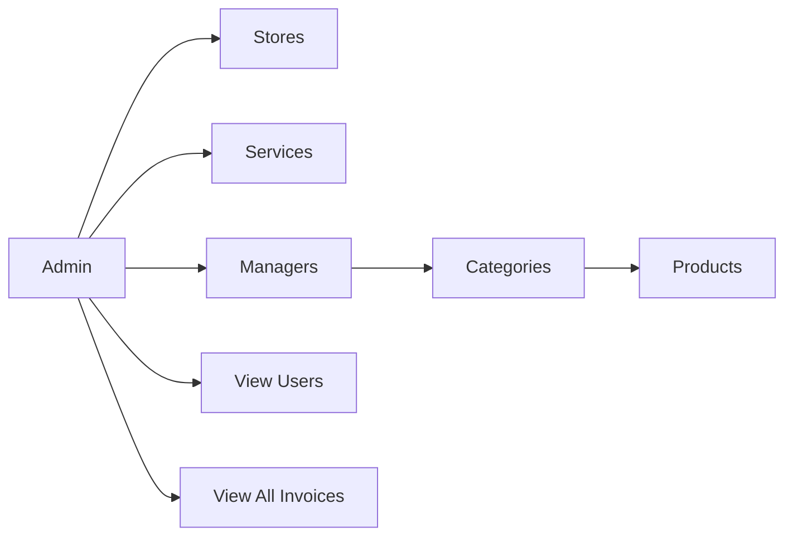

<!-- Animated Header -->
<p align="center">
  
</p>

<p align="center">
  
  
  
</p>

<p align="center">
  <a href="./README.md">🏠 Main README</a> •
  <a href="./MANAGER.md">🏪 Manager</a> •
  <a href="./USER.md">👤 User</a>
</p>

---

## 📖 Overview

The **Admin** is the mall owner and has full control of the system. They create the Stores (sections), add the Managers (shop owners), manage Services, and monitor every user and invoice.



---

## 🔑 Permissions

### 1️⃣ Manage Stores (sections)

A Store is a main section such as **Phones**, **Tablets**, or **Laptops**.

| Action | Description |
| --- | --- |
| ➕ Add | Add a new Store (name + image) |
| 👁️ Show | View all Stores |
| ✏️ Edit | Update a Store |
| 🗑️ Delete | Delete a Store |

### 2️⃣ Manage Services

Services available on the site.

| Action | Description |
| --- | --- |
| ➕ Add | Add a service |
| 👁️ Show | View all services |
| ✏️ Edit | Update a service |
| 🗑️ Delete | Delete a service |

### 3️⃣ Manage Managers (shop owners)

Each Manager has:

- Name
- Email
- Password
- Address
- Phone number
- Image
- The Store they belong to

> 📌 For example, if the mall has 5 phone shops, each shop has its own Manager, and all of them belong to the **Phones** Store.

| Action | Description |
| --- | --- |
| ➕ Add | Add a Manager and link them to a Store |
| 👁️ Show | View all Managers |
| ✏️ Edit | Update their data |
| 🗑️ Delete | Delete them |

### 4️⃣ View Users

- View all users registered in the system.

### 5️⃣ View Invoices

- View **all** purchases made by any user on the site.
- Each invoice shows: user name, products, quantities, total, payment method, payment status, and date.

---

## 📊 Home Page (Analytics)

The Admin home page shows statistic cards:

| Card | Source |
| --- | --- |
| 👥 Number of Users | `showuser` |
| 🧑‍💼 Number of Managers | `showmanger` |
| 🏬 Number of Stores | `showstore` |
| 🗂️ Number of Categories | `showcategorey` |
| 📦 Number of Products | `showproduct` |
| 🧾 Number of Orders | `showallinvoices` |

Below the cards is a **dynamic chart** (Bar or Pie) that updates automatically as the data changes.

### 📈 Extra Chart Ideas

| Chart | Data |
| --- | --- |
| **Line** | Sales per month (from `createdAt` and `total` in invoices) |
| **Pie** | Payment method distribution (Visa / InstaPay / ...) |
| **Bar** | Top-selling Stores |
| **Bar** | Top-selling Managers |

<details>
<summary><b>💡 Fetching all analytics data at once</b></summary>

```javascript
"use client";
import { useEffect, useState } from "react";
import { ENDPOINTS } from "@/config/api";

export default function Analysis() {
  const [counts, setCounts] = useState({});

  useEffect(() => {
    const keys = Object.keys(ENDPOINTS);

    Promise.allSettled(
      keys.map((k) => fetch(ENDPOINTS[k]).then((r) => r.json()))
    ).then((results) => {
      const next = {};
      results.forEach((r, i) => {
        if (r.status === "fulfilled") {
          const d = r.value;
          const list = d.data || d.user || d.products || d.invoices || [];
          next[keys[i]] = list.length;
        }
      });
      setCounts(next);
    });
  }, []);

  return /* render cards + chart using counts */;
}
```

`Promise.allSettled` keeps the page working even if one endpoint fails.

</details>

---

## 📄 Pages

| Page | Title |
| --- | --- |
| Home (Analysis) | Dashboard |
| Add Store | Add Store |
| Show Stores | All Stores |
| Add Service | Add Service |
| Show Services | All Services |
| Add Manager | Add Manager |
| Show Managers | Managers |
| Show Users | Users |
| Invoices | Invoices |

---

## ⚠️ Notes

- 🔒 The backend must check `role === "admin"` on every route above.
- 🏬 **Deleting a Store:** decide what happens to its Managers and categories. Block the deletion, or delete them too?
- 🧑‍💼 **Deleting a Manager:** decide what happens to their products.

<p align="center">
  
</p>