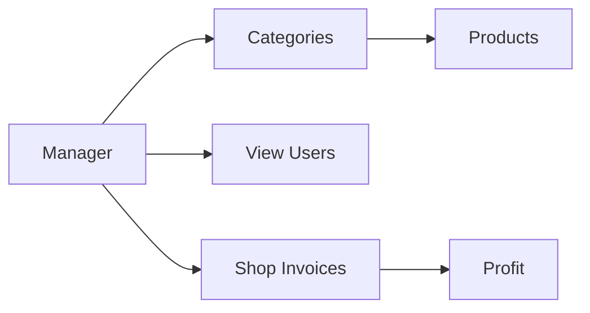
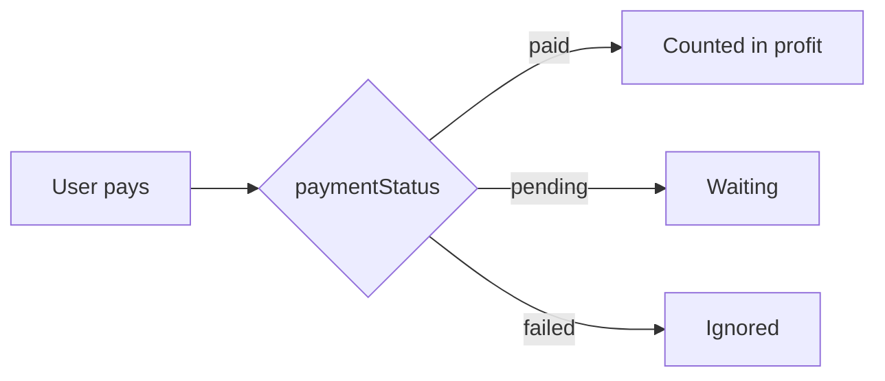

<!-- Animated Header -->
<p align="center">
  
</p>

<p align="center">
  
  
  
</p>

<p align="center">
  <a href="./README.md">🏠 Main README</a> •
  <a href="./ADMIN.md">👨‍💼 Admin</a> •
  <a href="./USER.md">👤 User</a>
</p>

---

## 📖 Overview

The **Manager** is the shop owner. The Admin creates them and links them to a Store. They manage their own categories and products, and track their shop's invoices and profit.



---

## 🔑 Permissions

### 1️⃣ Manage Categories

Each Manager adds the categories for their own shop.

> 📌 Example (phone shop): **Samsung** / **iPhone** / **Xiaomi**.

| Action | Description |
| --- | --- |
| ➕ Add | Add a category (name + image) |
| 👁️ Show | View the shop's categories |
| ✏️ Edit | Update |
| 🗑️ Delete | Delete |

### 2️⃣ Manage Products

Each category has its own products.

Product fields:

- Name
- Price
- Available quantity
- Image
- The category it belongs to

| Action | Description |
| --- | --- |
| ➕ Add | Add a product |
| 👁️ Show | View products |
| ✏️ Edit | Update (price / quantity / ...) |
| 🗑️ Delete | Delete |

### 3️⃣ View Users

- View the users available in the system.

### 4️⃣ Invoices and Profit

- Sees the invoices for **their shop only**.
- Each invoice shows the name of the user who bought.
- Can see how much profit they made from invoices.

> 📌 Example: the shop lists 10 products and a customer buys 3. The invoice records the 3 products, their quantities, and the total price.

---

## 💰 Profit Calculation

Profit is calculated from invoices with status `paid` only:

```js
const totalProfit = invoices
  .filter((inv) => inv.paymentStatus === "paid")
  .reduce((sum, inv) => sum + inv.total, 0);
```

> 💡 For **net profit** (not just revenue), add a `costPrice` field to the product.
> Profit = (selling price − cost price) × quantity.

### 📊 Suggested Dashboard Cards

| Card | Description |
| --- | --- |
| 💵 Total profit | Sum of paid invoices |
| 🧾 Number of orders | Number of invoices |
| 📦 Number of products | The shop's products |
| 🏆 Best-selling product | From invoice items |
| ⚠️ Low stock | Quantity below a threshold |

<details>
<summary><b>💡 Example: best-selling product and low stock</b></summary>

```js
// Best-selling product (from paid invoices)
const sales = {};
invoices
  .filter((inv) => inv.paymentStatus === "paid")
  .forEach((inv) =>
    inv.items.forEach((item) => {
      const id = item.product._id || item.product;
      sales[id] = (sales[id] || 0) + item.quantity;
    })
  );

const bestSellingId = Object.keys(sales).sort((a, b) => sales[b] - sales[a])[0];

// Low stock (threshold = 5)
const lowStock = products.filter((p) => p.quantity < 5);
```

</details>

---

## 💳 Payments as Seen by the Manager

When a User pays (simulated) and the transaction completes (`paid`), it appears for the Manager so they can calculate profit.



Available filters:

| Filter | Values |
| --- | --- |
| By payment status | `paid` / `pending` / `failed` |
| By payment method | Visa / InstaPay / ... |
| By date | Day / month / range |

---

## ⚠️ Notes

- 🔒 The backend must filter data by `manager._id` so a Manager never sees another shop's invoices or products.
- 📉 When a User buys, the product quantity should decrease. If it reaches zero, show the product as unavailable.
- 🧾 Once the transaction completes, the invoice is saved **once** and appears for both the Manager and the Admin.

<p align="center">
  
</p>