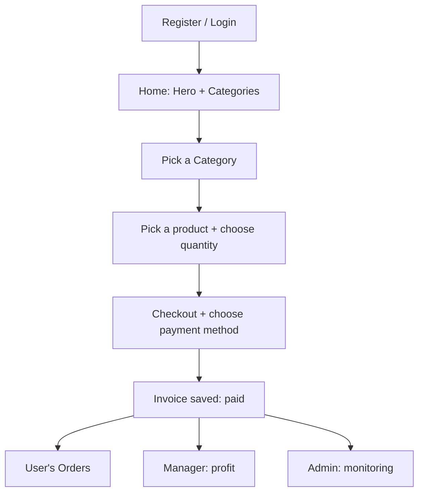

<!-- Animated Header -->
<p align="center">
  
</p>

<p align="center">
  
  
  
</p>

<p align="center">
  <a href="./README.md">🏠 Main README</a> •
  <a href="./ADMIN.md">👨‍💼 Admin</a> •
  <a href="./MANAGER.md">🏪 Manager</a>
</p>

---

## 📖 Overview

The **User** is the customer who browses and buys from the shops.

---

## 📄 Pages

| Page | Description |
| --- | --- |
| 🏠 Home | Hero section + all categories |
| 🗂️ Category | Products of a specific category |
| 📦 Product | Product details |
| 🛒 Cart / Checkout | Cart and completing the purchase |
| 🧾 Orders | The user's orders |
| 🛎️ Services | Available services |
| ℹ️ About | About the site |
| ✉️ Contact | Contact page |

---

## 🧭 User Journey



---

## 1️⃣ Home Page

- **Hero section**: main banner with a call to action.
- **Categories**: shows all categories. Clicking one opens its products.

Link:

```jsx
<Link href={`/Fetures/categorey/${e._id}`}>
```

## 2️⃣ Products and Buying

- View all available products in a category.
- Choose a **quantity**, which must not exceed the available stock.
- A product with zero quantity shows **"Unavailable"** and can't be bought.

## 3️⃣ Payment (Simulation)

Available payment methods:

| Method | Status |
| --- | --- |
| 💳 Visa | Available |
| 📱 InstaPay | Available |
| ➕ Any other | Add as needed |

> 💳 There is no real payment. The UI collects the data and saves the transaction in the database only.

> ⚠️ **Warning:** never store the full card number or CVV, even in a simulation. Store only the **last 4 digits**.

## 4️⃣ Orders

The User can track their orders, with a **filter** showing payment details:

| Detail | Values |
| --- | --- |
| Payment status | `paid` / `pending` / `failed` |
| Payment method | Visa / InstaPay / ... |
| Date | Day / month / range |
| Total | Order total |

When the transaction completes (`paid`), it appears for the Manager so they can calculate profit.

---

## 🧾 Invoice Created on Purchase

```json
{
  "user": "userId",
  "manager": "managerId",
  "items": [
    { "product": "productId", "quantity": 3, "price": 1500 }
  ],
  "total": 4500,
  "paymentMethod": "visa",
  "paymentStatus": "paid"
}
```

> 🏬 If the cart contains products from more than one shop, create a **separate invoice for each Manager**.

<details>
<summary><b>💡 Example: splitting a cart into one invoice per Manager</b></summary>

```js
function splitCartByManager(cartItems) {
  const groups = {};

  cartItems.forEach((item) => {
    const managerId = item.product.manager;
    if (!groups[managerId]) groups[managerId] = [];
    groups[managerId].push({
      product: item.product._id,
      quantity: item.quantity,
      price: item.product.price,
    });
  });

  return Object.entries(groups).map(([manager, items]) => ({
    manager,
    items,
    total: items.reduce((sum, i) => sum + i.price * i.quantity, 0),
  }));
}
```

</details>

---

## ⚠️ Notes

- 🔒 A User sees only their own orders. The backend filters by `user._id`.
- 🚪 Protect the checkout and Orders pages so unauthenticated users are redirected to login.
- 🖼️ Images: if the backend returns only a file name, prepend the base URL.
- 🏷️ Each page should have its own `metadata` (for example `Orders` and `Contact`).

<p align="center">
  
</p>