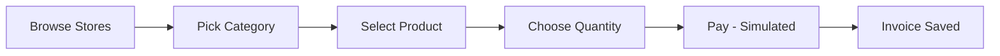
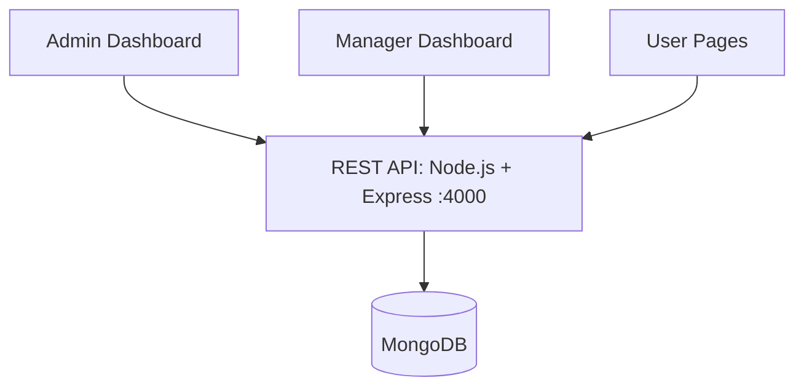
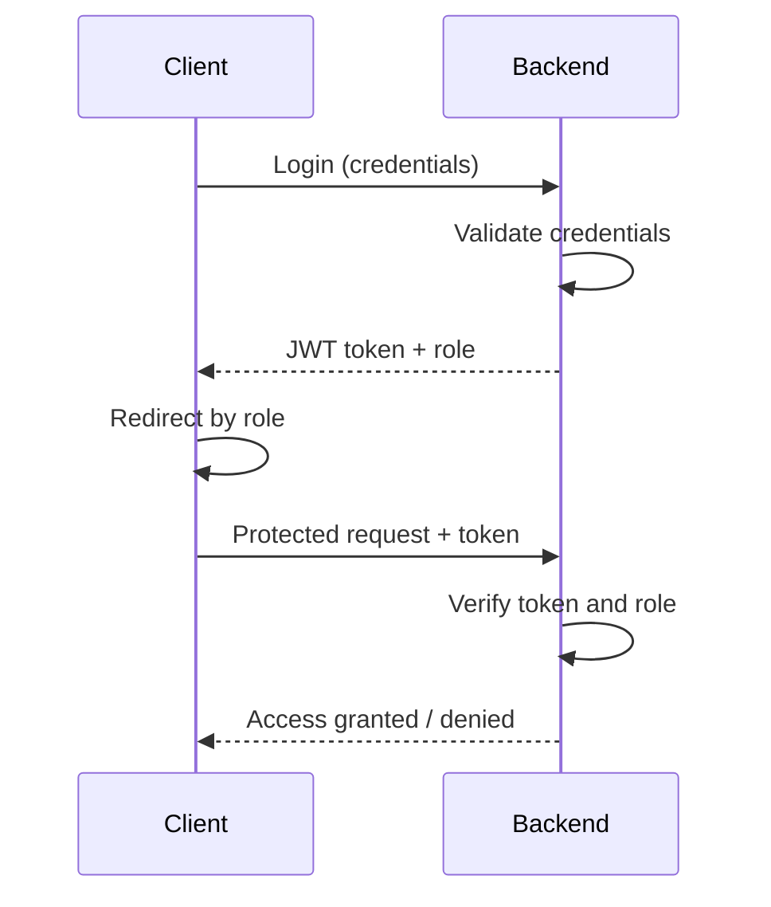
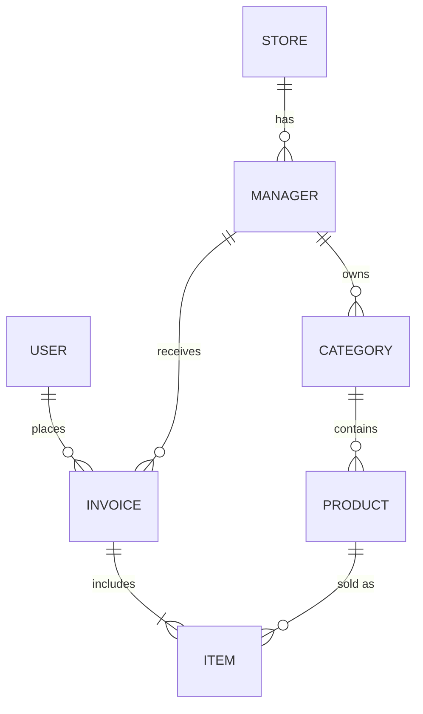

<!-- Animated Header -->
<p align="center">
  
</p>

<p align="center">
  
</p>

<p align="center">
  
  
  
  
  
  
  
  
</p>

<p align="center">
  <a href="https://YOUR-LIVE-DEMO-URL"></a>
  <a href="https://github.com/YOUR-USERNAME/YOUR-REPO"></a>
</p>

<p align="center">
  <a href="#-features">Features</a> •
  <a href="#-screenshots">Screenshots</a> •
  <a href="#%EF%B8%8F-tech-stack">Tech Stack</a> •
  <a href="#%EF%B8%8F-architecture">Architecture</a> •
  <a href="#-api">API</a> •
  <a href="#%EF%B8%8F-installation">Installation</a>
</p>

---

## 📖 Overview

A full-stack **Point of Sale system that simulates a shopping mall with multiple shops**. It has three roles, each with its own dashboard and permissions.

> 💳 Payment is a **simulation** only: a UI plus saving the data in the database, with no real payment processing.

Imagine a mall with 5 phone shops:

| 👨‍💼 Admin | 🏪 Manager | 👤 User |
| --- | --- | --- |
| The **mall owner**. Adds sections (Stores) such as Phones, Tablets, and Laptops, and adds the owner of each shop | The **shop owner**. Adds their own categories and products, and tracks sales and profit | The **customer**. Browses products, buys, and tracks their orders |

**Example:** a shop lists 10 products and a customer buys 3. The invoice is recorded under the customer's name and appears for the Manager (profit) and the Admin (monitoring).

---

## 🚀 Features

### 🔐 Authentication & Authorization

- Registration and login
- JWT authentication
- Role-based authorization (`admin` / `manager` / `user`)
- Protected routes (verified on the **backend**, not just the frontend)
- Logout

### 👥 Features by Role

| 👨‍💼 Admin | 🏪 Manager | 👤 User |
| --- | --- | --- |
| Add, view, edit, delete **stores** | Log in to own dashboard | Register, log in, log out |
| Add, view, edit, delete **services** | Add, edit, delete **categories** | Browse stores, categories, and products |
| Add, view, edit, delete **managers** | Add, edit, delete **products** | Add products to cart in any quantity |
| View and manage **users** | View customers who bought from the shop | **Pay** (simulated) |
| View **all invoices** | View shop **invoices** | Track own orders and invoices |
| Analytics dashboard with charts | View sales and **profit** | About, Contact, and Services pages |

### 🧾 Purchase Flow



- **Managers** see the invoice and their profit.
- **Admins** can monitor every invoice across all shops.
- **Users** track their orders by payment status.

### 🔁 CRUD Operations

Full Create / Read / Update / Delete for **Stores, Services, Managers, Categories, and Products**.

---

## 📸 Screenshots

> Put your images inside a `screenshots/` folder with these names (or change the paths below).

### 👤 User Platform

| Home | Products | Checkout |
| :---: | :---: | :---: |
|  |  |  |

### 👨‍💼 Admin Dashboard

| Analytics | Stores | Invoices |
| :---: | :---: | :---: |
|  |  |  |

### 🏪 Manager Dashboard

| Dashboard | Products |
| :---: | :---: |
|  |  |

---

## 🛠️ Tech Stack

| Layer | Technologies |
| --- | --- |
| **Frontend** | <br/><sub>Next.js App Router • Recharts • Font Awesome</sub> |
| **Backend** | <br/><sub>REST APIs • JWT • bcrypt</sub> |
| **Database** | <br/><sub>MongoDB (ObjectId `_id`)</sub> |

> Edit this table if your stack is different.

---

## 🏗️ Architecture



### 🔑 Authentication Flow



```text
role = admin    →  Admin Dashboard
role = manager  →  Manager Dashboard
role = user     →  User Home
```

> ⚠️ **Important:** the backend must verify the role on every protected route, not just the frontend, because anyone can open a URL manually.

### 🗄️ Database Schema



<details>
<summary><b>Show full schema</b></summary>

```text
User      { name, email, password, role, phone, address, img }
Store     { name, img }
Manager   { name, email, password, address, phone, img, store → Store }
Service   { name, description, img }
Category  { name, img, manager → Manager }
Product   { name, price, quantity, img, category → Category, manager → Manager }
Invoice   {
  user → User,
  manager → Manager,
  items: [{ product → Product, quantity, price }],
  total,
  paymentMethod,     // visa | instapay | ...
  paymentStatus,     // pending | paid | failed
  createdAt
}
```

Passwords are stored **hashed** (bcrypt), never as plain text.

</details>

---

## 📁 Project Structure

<details>
<summary><b>Show structure</b></summary>

```text
POS-System/
├── backend/
│   ├── controller/
│   ├── model/
│   ├── routes/
│   ├── middleware/
│   ├── server.js
│   └── package.json
└── frontend/
    └── src/app/
        ├── Fetures/
        │   ├── Admin/
        │   │   ├── Homepage/        ← analytics and charts
        │   │   └── components/      ← Sidebar, Analysis, etc.
        │   ├── Manager/
        │   ├── user/
        │   │   └── product/[id]/
        │   └── categorey/
        │       └── [id]/
        ├── layout.jsx
        └── page.jsx
```

</details>

---

## 🔌 API

Base URL: `http://localhost:4000`

| Purpose | Method | Endpoint |
| --- | :---: | --- |
| List users | `GET` | `/possysytem/userAuth/showuser` |
| List stores | `GET` | `/posystem/project/showstore` |
| List managers | `GET` | `/posystem/project/showmanger` |
| List categories | `GET` | `/posystem/project/showcategorey` |
| List products | `GET` | `/posystem/project/showproduct` |
| List all invoices | `GET` | `/posystem/project/showallinvoices` |

Response shape:

```json
{ "success": true, "data": [] }
```

> The data key varies by route: `user`, `data`, `products`, or `invoices`.

### 🧩 Centralized API Config

All URLs live in one file instead of being repeated across components:

```javascript
// config/api.js
const BASE_URL = process.env.NEXT_PUBLIC_API_URL || "http://localhost:4000";

export const API = `${BASE_URL}/posystem/project`;
export const AUTH_API = `${BASE_URL}/possysytem/userAuth`;

export const ENDPOINTS = {
  showStore: `${API}/showstore`,
  showManager: `${API}/showmanger`,
  showCategory: `${API}/showcategorey`,
  showProduct: `${API}/showproduct`,
  showAllInvoices: `${API}/showallinvoices`,
  showUser: `${AUTH_API}/showuser`,
};
```

---

## ⚙️ Installation

**1. Clone the repository**

```bash
git clone https://github.com/YOUR-USERNAME/YOUR-REPO.git
cd YOUR-REPO
```

**2. Backend**

```bash
cd backend
npm install
```

Create a `.env` file:

```env
PORT=4000
MONGO_URI=mongodb://localhost:27017/possystem
JWT_SECRET=your_secret
```

```bash
npm start            # http://localhost:4000
```

**3. Frontend**

```bash
cd frontend
npm install
npm install recharts
```

Create a `.env.local` file:

```env
NEXT_PUBLIC_API_URL=http://localhost:4000
```

```bash
npm run dev          # http://localhost:3000
```

> ⚠️ **Never upload your `.env` file to GitHub.** Add this to `.gitignore`:
>
> ```text
> .env
> .env.local
> node_modules
> .next
> ```

---

## 🧑‍💻 Development Notes

- Keep the API base URL in `NEXT_PUBLIC_API_URL` instead of hardcoding `localhost:4000`.
- Keep all fetch logic in a single `api.js` instead of repeating it.
- Use `Promise.allSettled` when fetching several endpoints at once (like the analytics page).
- Any component using `useState` or `useEffect` needs `"use client"` on the first line.
- Every page has its own `metadata` (title and description) via `export const metadata` in `page.jsx`.

---

## 🔒 Security

- JWT authentication
- Passwords hashed with bcrypt
- Role verified on every protected backend route
- Environment variables for sensitive configuration

---

## 🚧 Roadmap

- [ ] 🔐 Full auth (JWT + role-based route protection)
- [ ] 📊 Admin dashboard with charts
- [ ] 💰 Manager dashboard with profit
- [ ] 🛒 User product and cart pages
- [ ] 💳 Payment simulation and invoice saving


---

## 👨‍💻 Author

<p align="center">
  <b>Your Name</b><br/>
  Full-Stack Developer
</p>

<p align="center">
  <a href="https://github.com/YOUR-USERNAME"></a>
  <a href="https://www.linkedin.com/in/YOUR-USERNAME"></a>
  <a href="https://YOUR-PORTFOLIO-URL"></a>
</p>

<p align="center">
  
</p>